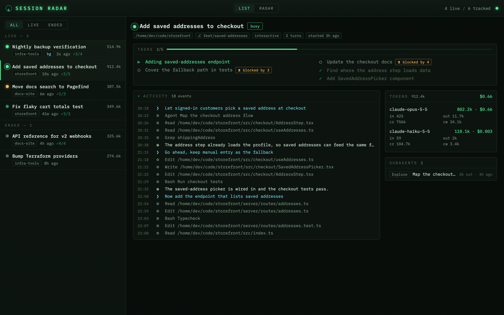
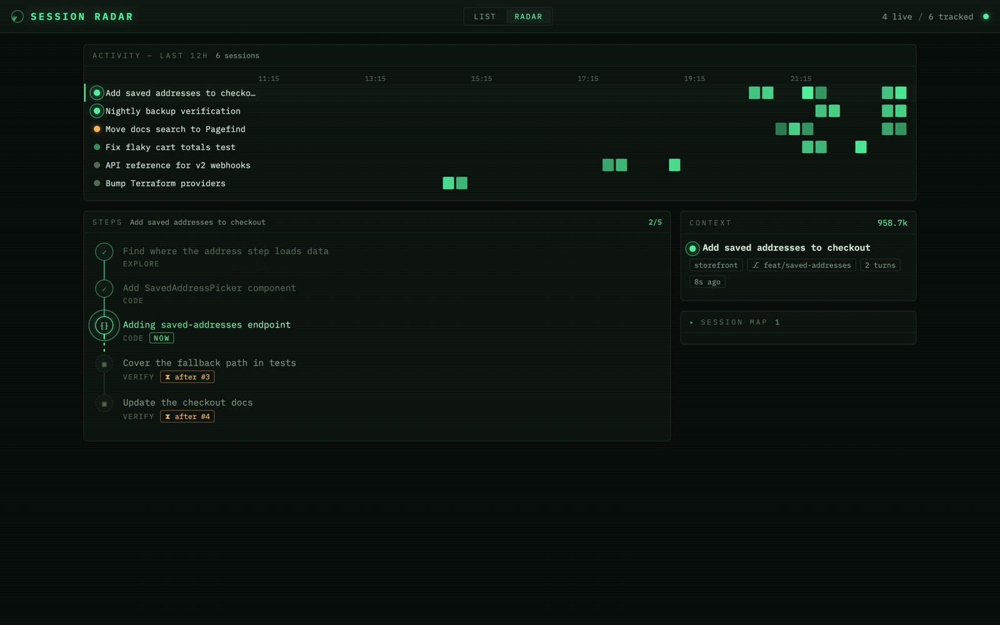

# session-radar

Live dashboard for local Claude Code sessions. It watches `~/.claude` read-only and shows each session's tasks, artifacts, subagents, token usage and estimated cost. Updates arrive in real time over SSE.

Two views (toggle in the top bar):

- **list**: session list with an all / live / ended filter, plus a detail pane: task checklist, collapsible activity timeline, artifacts, subagents, per-model token breakdown.
- **radar**: activity swimlanes (last 12 h, 15-min buckets, intensity = event count), the selected session's step flow, a session map graphing its subagents, artifacts/PRs and background job, and a context panel.





Both screenshots come from `bun run demo`, which generates fictional sessions.

## Run

```sh
bun install
bun start          # http://127.0.0.1:4747
bun dev            # --watch mode
bun test
bun run typecheck
```

`PORT` and `CLAUDE_CONFIG_DIR` env vars override defaults.

## Try it without your own data

```sh
bun run demo
```

Writes a synthetic Claude Code data directory to a temp dir and starts the normal server against it (`CLAUDE_CONFIG_DIR` points there). You get six fictional sessions across three projects (`storefront`, `docs-site`, `infra-tools`): two busy, one waiting, one idle, two ended, with task lists, subagents, a background job and a placeholder artifact. The busy sessions get a new transcript row every few seconds, so live updates are visible. Nothing under `~/.claude` is read. The temp dir is deleted on exit, Ctrl-C or SIGTERM.

## How it works

The server needs no hooks. It tails files Claude Code already writes:

| Source | Used for |
|---|---|
| `~/.claude/sessions/<pid>.json` | live sessions, busy/idle/waiting status |
| `~/.claude/projects/<slug>/<id>.jsonl` | tokens, timeline, titles, artifacts |
| `~/.claude/tasks/<id>/*.json` | task checklist (done / doing / left) |
| `<slug>/<id>/subagents/*` | subagent usage + descriptions |
| `~/.claude/jobs/<jobId>/state.json` | background jobs, published artifacts |

Transcripts are tailed incrementally by byte offset; usage rows are deduped by `message.id` (they repeat per content block). Costs come from a static price map in `src/shared/pricing.ts` (first-party API rates as of 2026-11-02). Update it when prices change. The tokens panel shows the session total and a per-model cost. A model with no price shows tokens only, and the total then reads as a lower bound (`≥ $1.23`). Haiku 5.5 bills prompts over 100K input tokens at a higher tier ($0.50 / $2.50 per MTok); costs are computed on per-model totals, not per request, so session-radar always applies the base rate and may undercount sessions with very large Haiku 5.5 prompts.

Notes on liveness: the registry's `updatedAt` only moves on status transitions, so "stale" means a busy session with no registry or transcript evidence for 30 min. Dead pids flip to ended within ~5 s.

## Layout

- `src/server/`: transcript parser, tailer, aggregator, readers (registry/tasks/jobs/subagents), store, fs watcher, Bun.serve + SSE
- `src/frontend/`: React 19, bundled by Bun via HTML import; no build step
- `src/shared/`: wire types + pricing
- `src/demo/`: synthetic data generator for `bun run demo`

Server binds `127.0.0.1` only and checks the `Host` header (transcripts are sensitive).
